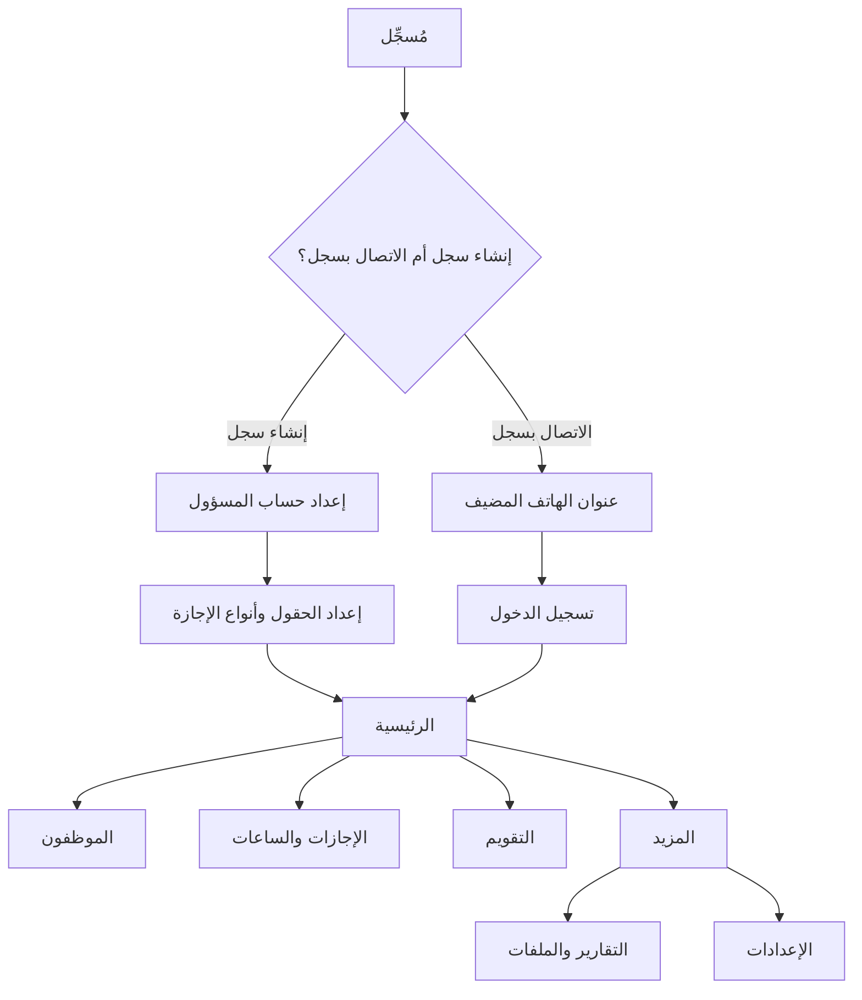

# مُسجِّل — proposed Android screen flow

This is an Android design proposal based on the agreed product behavior.
It does not depend on another application's screens, data, or implementation.
The screens below are planned, not yet built.

## Interface defaults

- Follow the phone's light/dark appearance setting.
- Start calendar weeks on Sunday; leave exclusion rules are configured separately.
- Support a calendar picker and direct typing in date fields, with the same
  real-date validation and straightforward access to dates across 30 years.
- Start day-based leave types with **إدارية**. Allow later additions/edits in
  settings; hourly entries remain their own separate category.

## First use

The owner phone works offline independently. Guests use the same local network
and pause shared operations if the host is unavailable. Hosting is an optional
session controlled from the owner phone, not a requirement for local daily use.

After a successful sign-in, Android resumes that session on later launches until
logout or revoked access. Guests reconnect without an unnecessary login prompt;
the host revalidates current permissions before allowing operations.

## Main navigation

Proposed five destinations: **الرئيسية — الموظفون — الإجازات — التقويم — المزيد**.

| Destination | Main content and actions |
| --- | --- |
| الرئيسية | Confirmed opening screen: summary with primary تسجيل إجازة action, secondary search/hour actions where permitted, contract/backup/connection status |
| الموظفون | Compact rows showing name, employee number, and department; search, filters, active/archive view, details and selected-employee bulk changes |
| الإجازات | Day leave and hourly history, employee/date filters, add entry, open one record for correction |
| التقويم | Monthly view and department/team filters, select a record to view/edit its form |
| المزيد | Reports, spreadsheet exchange, settings, backup/restore, accounts, and hosting controls where permitted |

The design target is 120 employees with 30 years of history. Employee timelines
and leave lists expose year/date-range filters and load bounded pages; calendars
load the selected month. Reports and backup/restore must retain access to the
full history, including archived employees and previous hourly-conversion years.
Managers see employees currently in their assigned departments and those
employees' records. Historical reports show the department saved on each record.

## Employee flow

Start with these fields, editable later through configuration:

| Field | Starting type |
| --- | --- |
| الاسم | Text |
| الرقم الوظيفي | Text, preserving leading zeros |
| الرقم الوطني | Text, preserving leading zeros |
| القسم | Department choice/reference |
| المسمى الوظيفي | Text |
| الهاتف | Text |
| تاريخ بدء العمل | Date |

The initial list does not automatically make every field mandatory. Required
flags remain configurable. Compact list rows open the complete employee details.

1. Search or filter employees; possible duplicate names/numbers/IDs are warnings.
2. Open details with profile, day leave, hourly totals, service, and contract information.
3. Add/edit configured fields, with the selected types and required flags.
4. Open service periods, manually enter deductions, or review a service target.
5. Print/share a plain ID card or generate a report for this employee.
6. Archive with a selected final working date; restore preserves history and a
   return to work starts a new service period under the retained planning default.

Bulk employee changes have their own selected-record preview. There is no bulk
editor for existing leave records. Group leave creation is still undecided.

Department changes update the current employee record with ordinary history;
no transfer timeline or special historical-access workflow is needed. Dated
records retain their saved department. Contract expiry shows a warning;
the user explicitly records renewal or a final working date, and service does
not stop merely because the contract-end date has arrived.

## Registering day leave

This is the main quick action from the opening summary screen for permitted
users. Enter through **تسجيل إجازة**, then follow the shared form below.

Choose employee, leave type, start/end dates, and optional notes. Show the
suggested whole-day amount; allow a whole-day adjustment before saving. If the
record spans years and the amount was adjusted, confirm the year allocation.
Show duplicate/overlap warnings with an authorized option to proceed.

Calendar changes open this same form. Corrections retain history; a reason is optional.

## Registering hours

Choose employee, date, positive whole hours, and optional notes. There is one
hourly category and no minutes input. Show the saved entry and updated yearly
totals: original hours, converted days, and remaining pending hours.

An 8-hour threshold initially applies. Settings can change it; completed
conversions retain their results and pending current-year hours use the new rate.
No pending-hour carryover occurs between years, and historical years stay viewable.

## Reports and file exchange

- Select employee(s), period where applicable, and report sections: profile,
  service, day leave, and hours. Preview, then export PDF or editable Word.
  Group historical records by their saved department and apply the same simple
  current-employee-department access check to previews and generated files.
- Generate a plain employee ID card with name, employee number, and department.
  No QR code is included.
- Organization name/logo will be supplied later. Provide optional branding
  settings and allow reports/cards to work before those details are available.
- Excel/CSV import: select file, map fields, review employee matches and changes,
  resolve validation issues, and confirm. Blank/unmapped update cells preserve
  current values. Clearing uses an explicit action visible in the preview.
- Export employee records through the same file area using the supported formats.

## Settings and recovery

- Custom field types, dropdown choices, ordering, and required flags.
- Departments, classifications, tags/groups, and memberships.
- Day-based leave types and their weekday/holiday exclusion rules.
- Manually entered named holiday dates.
- Hour conversion threshold, with the effect on current-year pending hours shown.
- Accounts and the proposed role permissions.
- Assigned departments for managers, with the same restriction across all screens
  and host requests, and a logout action for persistent signed-in sessions.
- Optional organization name/logo for printed output, to be supplied later.
- Weekly automatic backup, manual backup, last-success status, chosen destination,
  and reviewed restore. Let the user choose a phone folder; retain 8 successful
  automatic weekly copies, while manual backups/exports remain until deleted.
- Start/stop phone hosting, show its connection address/state, and manage sessions.

## Design checks before implementation

- Keep Arabic RTL layout readable on small phones, including long names and fields.
- Ensure primary entry actions are easy to reach without duplicating business logic.
- Read-only users must not see enabled editing actions; the host also enforces access.
- Preserve form input during ordinary navigation and show the result of each saved action.
- Keep reports, cards, storage, and all packaged assets usable without internet.
- Test hosting on actual devices before promising availability with the screen locked.

Implementation milestones and detailed rules are in the [Android plan](ANDROID_PLAN.md).
